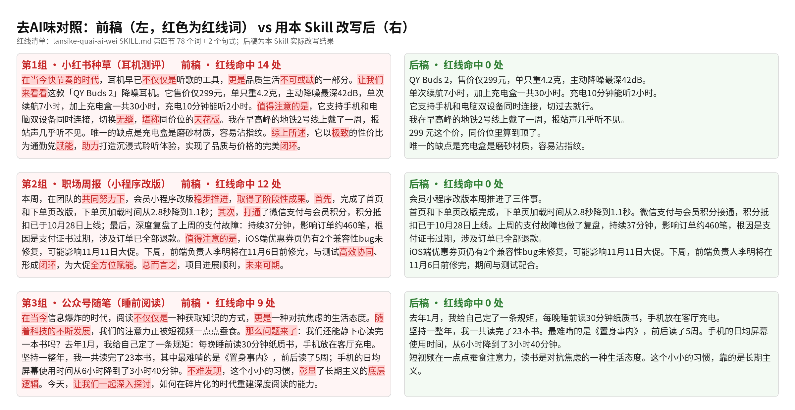

> 本项目是对三个开源项目的合并改造：[Humanizer-zh](https://github.com/op7418/Humanizer-zh)（作者 歸藏 / op7418）、[shuorenhua 说人话](https://github.com/MrGeDiao/shuorenhua)（作者 MrGeDiao）、[stop-slop-zh](https://github.com/pencil20388-eng/stop-slop-zh)（作者 pencil20388-eng / AdsPower Content Team）。我们把三家规则合并去重、统一成中文口径，新增了小红书 / 公众号 / 职场三档改写策略、一份统一检查清单和一张 AI 高频词替换表，并去掉了只在 Claude 里能用的字段，让豆包也能直接用。三份原 MIT 声明完整保留在 [THIRD_PARTY_LICENSES.md](THIRD_PARTY_LICENSES.md)。

# 懒斯克去AI味

**AI 写的稿子一眼假？丢给它，三档任选，改完像你本人写的。**

开头“在当今时代”，中间“不仅仅是……更是……”，结尾“让我们拭目以待”，满屏 ✨🌟 和“赋能、闭环、抓手”……这套 Skill 专门把这些东西剁掉。

但它比一般的“去 AI 味”狠在另一头：**数字、价格、日期、责任人、承诺、缺点，一个都不丢，也不给你编新的。** 改得像人，但意思不走样。

- 🎬 抖音：[www.douyin.com/user/MS4wLjABAAAAFSyZxZDN5ZLwtQxqrcvmoZ-8DK5Nnhd_YIMqVBJ9wDbzwvMfa2-FtPA7qjzaUOec](https://www.douyin.com/user/MS4wLjABAAAAFSyZxZDN5ZLwtQxqrcvmoZ-8DK5Nnhd_YIMqVBJ9wDbzwvMfa2-FtPA7qjzaUOec)
- 📺 B 站：[space.bilibili.com/3546724798827024](https://space.bilibili.com/3546724798827024)
- 📕 小红书：[www.xiaohongshu.com/user/profile/6252e858000000001000e9bb](https://www.xiaohongshu.com/user/profile/6252e858000000001000e9bb)

## 三档，一句话选

| 档位 | 适合 | 改完像谁 |
|---|---|---|
| **小红书档** | 种草、测评、探店、好物笔记 | 刚用完、忍不住安利的普通人 |
| **公众号档** | 观点文、长文、故事 | 懂行的朋友在跟你聊 |
| **职场档** | 周报、汇报、通知、工作邮件 | 靠谱同事，领导 10 秒看懂 |

用法就一句：“**用懒斯克去AI味，按小红书档改这段：……**”。不说档位它会自己判断，并告诉你选了哪档。

---

## 对照怎么看

对外讲「去 AI 味」时，用**一眼能认出来的套话**做反面：在当今这个快节奏的时代、值得注意的是、综上所述、不仅仅是……更是……、赋能 / 闭环 / 底层逻辑。  

**不要**把「绝绝子、家人们、谁懂啊」当 AI 味证据——那是小红书日常说法。另一组重 AI 味样本（由 AI 生成）及改写见 [examples/demo-heavy-ai-constructed.md](examples/demo-heavy-ai-constructed.md)。

## ① 本地智能体怎么装（WorkBuddy、Claude、Cursor 等）

### 一键：把这句话直接粘给你的智能体

```
请从 https://github.com/lansike/lansike-quai-ai-wei 下载「懒斯克去AI味」这个 Skill：把整个仓库 git clone（或下载 zip 解压）到你的用户级 skills 目录下，文件夹名用 lansike-quai-ai-wei，确保 SKILL.md 直接在这个文件夹里（不要多套一层目录）。装好后告诉我安装路径，然后用它按职场档改写这句话测试一下：“本周在团队的共同努力下，项目稳步推进，取得了阶段性成果。”
```

### 手动：git clone 到对应的 skills 目录

本仓库根目录就是 Skill 文件夹（`SKILL.md` 在根目录），clone 下来直接能用。文件夹名请保持 `lansike-quai-ai-wei`（Cursor 要求它和 SKILL.md 里的 `name` 一致）。

| 智能体 | 用户级目录（所有项目可用） | 项目级目录（只在当前项目） |
|---|---|---|
| Claude Code | `~/.claude/skills/` | `<项目>/.claude/skills/` |
| Cursor | `~/.cursor/skills/`（也认 `~/.agents/skills/`，并兼容读取 `~/.claude/skills/`） | `<项目>/.cursor/skills/` 或 `<项目>/.agents/skills/` |
| WorkBuddy | 官方文档没写具体路径，用上面那句话让它按自己的 skill 规范装，或在「技能」页点「添加技能 → 上传技能」导入 | 同左 |

以 Claude Code 为例，macOS / Linux：

```bash
git clone https://github.com/lansike/lansike-quai-ai-wei.git ~/.claude/skills/lansike-quai-ai-wei
```

Windows（PowerShell）：

```powershell
git clone https://github.com/lansike/lansike-quai-ai-wei.git "$env:USERPROFILE\.claude\skills\lansike-quai-ai-wei"
```

换成 Cursor，就把 `.claude` 换成 `.cursor`。没装 git 的话，在 GitHub 页面点 Code → Download ZIP，解压后把里面那层含 `SKILL.md` 的文件夹放进去。解压出来的文件夹名会带「-main」（如 `lansike-quai-ai-wei-main`），这是 GitHub 自动加的，正常；放进去后把文件夹改名为 `lansike-quai-ai-wei` 即可。

目录依据（官方文档）：[Claude Code · Skills](https://code.claude.com/docs/en/skills)、[Cursor · Agent Skills](https://cursor.com/docs/context/skills)、[WorkBuddy · 技能](https://www.workbuddy.ai/docs/zh/workbuddy/From-Beginner-to-Expert-Guide/Function-Description/Skills-Market)。

装完最好**新开一个会话**，有的智能体只在会话启动时扫描技能目录。不自动触发就点名：“用懒斯克去AI味改……”。

---

## ② 豆包怎么用

这是纯文字 Skill，没有任何要运行的代码，豆包直接能用。两种办法：

**办法一：当提示词用（最快）**

1. 打开本仓库的 [SKILL.md](SKILL.md)，全选复制全文。
2. 在豆包对话框里粘贴，后面接一句：“以上是规则。请按小红书档改写下面这段：……”
3. 同一个对话里接着贴别的稿子就行，不用重复粘规则。

**办法二：自建一个专用智能体（一劳永逸）**

1. 豆包里点「创建智能体」。
2. 名字填“懒斯克去AI味”，把 SKILL.md 全文粘进「设定 / 人设与回复逻辑」。
3. 以后打开这个智能体，直接贴稿子，说一句“按职场档”就行。

SKILL.md 自带完整的红线词表和三档规则，`references/` 里的文件是加强版细则，豆包里不贴也能用。

---

## 前后对比效果

改前稿由 AI 生成，未使用本 Skill；改后稿是用本 Skill 改写的结果，和视频里的是同三组。三组前后全文和逐组命中词见 [examples/video-demo.md](examples/video-demo.md)。



| 档位 | 原文（节选） | 改写后（节选） |
|---|---|---|
| 小红书 | 在当今快节奏的时代，耳机早已不仅仅是听歌的工具，更是品质生活不可或缺的一部分。……综上所述，它以极致的性价比为通勤党赋能，助力打造沉浸式聆听体验，实现了品质与价格的完美闭环。 | QY Buds 2，售价仅299元，单只重4.2克，主动降噪最深42dB。……299 元这个价，同价位里算到顶了。 |
| 职场 | 本周，在团队的共同努力下，会员小程序改版稳步推进，取得了阶段性成果。首先，完成了首页和下单页改版…… | 会员小程序改版本周推进了三件事。首页和下单页改版完成，下单页加载时间从2.8秒降到1.1秒。 |
| 公众号 | 在当今信息爆炸的时代，阅读不仅仅是一种获取知识的方式，更是一种对抗焦虑的生活态度。随着科技的不断发展…… | 去年1月，我给自己定了一条规矩，每晚睡前读30分钟纸质书，手机放在客厅充电。 |

自查结果：红线词命中三段分别 **14→0、12→0、9→0**（78 词 + 2 句式口径），明细见 [examples/video-demo.md](examples/video-demo.md)；原文里的数字（299 元、4.2 克、42dB、2.8 秒→1.1 秒、37 分钟、约 460 笔、11 月 6 日、23 本、3 小时 40 分钟……）**一个没丢**，也没有新增原文没有的经历和数据。

> 说清楚：这只是 3 段样例，不代表所有稿子都能改到这个程度；本 Skill **不保证能通过任何 AI 检测**，也不判断一段字是不是 AI 写的。

---

## 跟原项目比，改了什么

- **三合一，去重**：Humanizer-zh 的 31 条模式 + 说人话的编辑边界 + stop-slop-zh 的禁用词/标点/结构，合并成“14 种症状 + 1 张红线词表 + 1 份检查清单”。
- **新增三档**：同一条规则在不同场景狠度不同。比如冒号，小红书和公众号少用，职场原文有的“风险：……”可以留、但不为显得精炼新加；列表，公众号尽量改段落，周报邮件反而该分条；敬语，邮件留称呼和落款，其他档全删。
- **规则冲突怎么裁**：stop-slop-zh 要求全文冒号、双引号清零，并强制每篇塞 8–10 个口语词；Humanizer-zh 和说人话则主张不机械删、不硬塞。我们的取舍是：**破折号三档都清零，冒号按档位，双引号不强改；口语词改成“上限”而不是“下限”**，因为硬塞“说真的、坦率地讲”本身就是新的 AI 味。
- **新增“红线词”机制**：哪些词改完必须清零、哪些看语境（黄线），写死在表里，方便自查。
- **保真铁律放最前**：不加料、不丢料、不改强度、归因留着、时态和计划语气原样留（“下周”“将”“预计”“可能”不能丢），放在所有手法之前，冲突时铁律赢。
- **去掉 Claude 专用字段**（`allowed-tools` 等），frontmatter 只留 `name` 和 `description`，各家智能体和豆包都能直接读。
- 去掉了 stop-slop-zh 里面向“从零写稿”的部分（动笔前核查、切入角度、写作结构），本 Skill 只管**改稿**。

## 文件说明

```
lansike-quai-ai-wei/
├── SKILL.md                    主规则（自成一体，豆包只贴这一份也能用）
├── references/
│   ├── ai-words.md             AI 高频词 / 句式替换表（红线 + 黄线）
│   ├── xiaohongshu.md          小红书档规则卡
│   ├── gongzhonghao.md         公众号档规则卡
│   └── zhichang.md             职场档规则卡（含周报骨架）
├── examples/
│   ├── video-demo.md           视频里的三组：改前 / 改后全文、红线词命中数
│   ├── video-demo.png          视频里的三组：前后对比图
│   └── demo-heavy-ai-constructed.md  另一组重 AI 味样本及改写
├── README.md
├── LICENSE                     本项目新内容的 MIT 许可（lansike）
└── THIRD_PARTY_LICENSES.md     三个原项目及其上游的 MIT 声明原文
```

## 许可

- 本项目新写的内容：MIT，Copyright (c) 2026 lansike，见 [LICENSE](LICENSE)。
- 改编自 Humanizer-zh（Copyright (c) 2026 歸藏）、shuorenhua（Copyright (c) 2026 MrGeDiao）、stop-slop-zh（Copyright (c) 2026 AdsPower Content Team）的部分，以及它们的上游 blader/humanizer（Copyright (c) 2025 Siqi Chen）、hardikpandya/stop-slop（Copyright (c) 2025 Hardik Pandya），原 MIT 声明全文见 [THIRD_PARTY_LICENSES.md](THIRD_PARTY_LICENSES.md)。

感谢三位原作者把规则开源出来。觉得好用，也去给原项目点个星。
