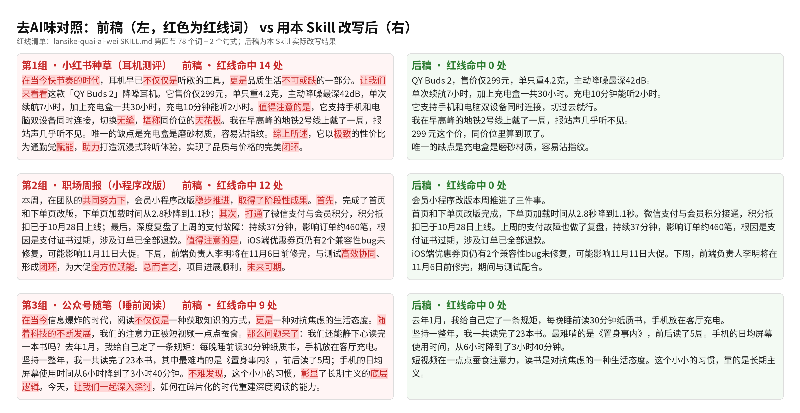

# 三组改前 / 改后全文

改前稿由 AI 生成，未使用本 Skill；改后稿是用本 Skill 改写的结果，前后全文原样收录。

红线词口径：[SKILL.md](../SKILL.md) 第四节的 78 个红线词 + 2 个句式（“不仅仅是／不仅是……更是……”“首先……其次……”）。平台口语不算 AI 味，不计入命中。



---

## 第1组 · 小红书种草（耳机测评）：红线词命中 14 → 0

改前命中：值得注意的是、让我们来看看、快节奏的时代、综上所述、不可或缺、在当今、天花板、极致、堪称、无缝、赋能、闭环、助力、不仅仅是…更是…。改后命中：无。

### 改前

```text
在当今快节奏的时代，耳机早已不仅仅是听歌的工具，更是品质生活不可或缺的一部分。让我们来看看这款「QY Buds 2」降噪耳机。它售价仅299元，单只重4.2克，主动降噪最深42dB，单次续航7小时，加上充电盒一共30小时，充电10分钟能听2小时。值得注意的是，它支持手机和电脑双设备同时连接，切换无缝，堪称同价位的天花板。我在早高峰的地铁2号线上戴了一周，报站声几乎听不见。唯一的缺点是充电盒是磨砂材质，容易沾指纹。综上所述，它以极致的性价比为通勤党赋能，助力打造沉浸式聆听体验，实现了品质与价格的完美闭环。
```

### 改后

```text
QY Buds 2，售价仅299元，单只重4.2克，主动降噪最深42dB。

单次续航7小时，加上充电盒一共30小时。充电10分钟能听2小时。

它支持手机和电脑双设备同时连接，切过去就行。

我在早高峰的地铁2号线上戴了一周，报站声几乎听不见。

299 元这个价，同价位里算到顶了。

唯一的缺点是充电盒是磨砂材质，容易沾指纹。
```

---

## 第2组 · 职场周报（小程序改版）：红线词命中 12 → 0

改前命中：取得了阶段性成果、值得注意的是、共同努力下、总而言之、未来可期、稳步推进、高效协同、全方位、赋能、打通、闭环、首先…其次…。改后命中：无。

### 改前

```text
本周，在团队的共同努力下，会员小程序改版稳步推进，取得了阶段性成果。首先，完成了首页和下单页改版，下单页加载时间从2.8秒降到1.1秒；其次，打通了微信支付与会员积分，积分抵扣已于10月28日上线；最后，深度复盘了上周的支付故障：持续37分钟，影响订单约460笔，根因是支付证书过期，涉及订单已全部退款。值得注意的是，iOS端优惠券页仍有2个兼容性bug未修复，可能影响11月11日大促。下周，前端负责人李明将在11月6日前修完，与测试高效协同、形成闭环，为大促全方位赋能。总而言之，项目进展顺利，未来可期。
```

### 改后

```text
会员小程序改版本周推进了三件事。

首页和下单页改版完成，下单页加载时间从2.8秒降到1.1秒。微信支付与会员积分接通，积分抵扣已于10月28日上线。上周的支付故障也做了复盘，持续37分钟，影响订单约460笔，根因是支付证书过期，涉及订单已全部退款。

iOS端优惠券页仍有2个兼容性bug未修复，可能影响11月11日大促。下周，前端负责人李明将在11月6日前修完，期间与测试配合。
```

---

## 第3组 · 公众号随笔（睡前阅读）：红线词命中 9 → 0

改前命中：随着科技的不断发展、那么问题来了、让我们一起、不难发现、深入探讨、底层逻辑、在当今、彰显、不仅仅是…更是…。改后命中：无。

### 改前

```text
在当今信息爆炸的时代，阅读不仅仅是一种获取知识的方式，更是一种对抗焦虑的生活态度。随着科技的不断发展，我们的注意力正被短视频一点点蚕食。那么问题来了：我们还能静下心读完一本书吗？去年1月，我给自己定了一条规矩：每晚睡前读30分钟纸质书，手机放在客厅充电。坚持一整年，我一共读完了23本书，其中最难啃的是《置身事内》，前后读了5周；手机的日均屏幕使用时间从6小时降到了3小时40分钟。不难发现，这个小小的习惯，彰显了长期主义的底层逻辑。今天，让我们一起深入探讨，如何在碎片化的时代重建深度阅读的能力。
```

### 改后

```text
去年1月，我给自己定了一条规矩，每晚睡前读30分钟纸质书，手机放在客厅充电。

坚持一整年，我一共读完了23本书。最难啃的是《置身事内》，前后读了5周。手机的日均屏幕使用时间，从6小时降到了3小时40分钟。

短视频在一点点蚕食注意力，读书是对抗焦虑的一种生活态度。这个小小的习惯，靠的是长期主义。
```
